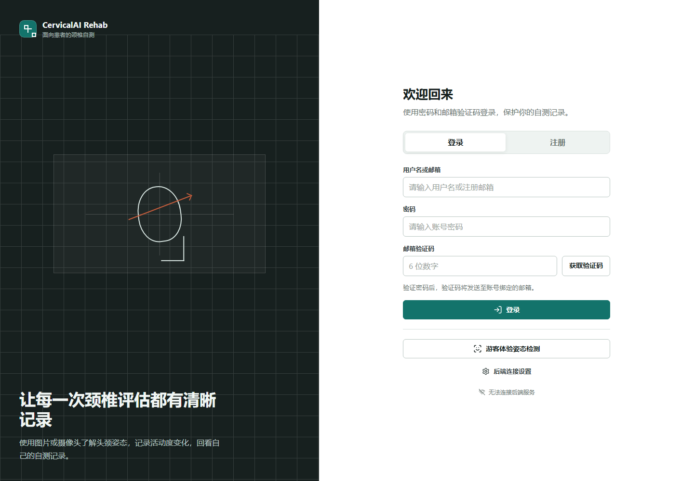
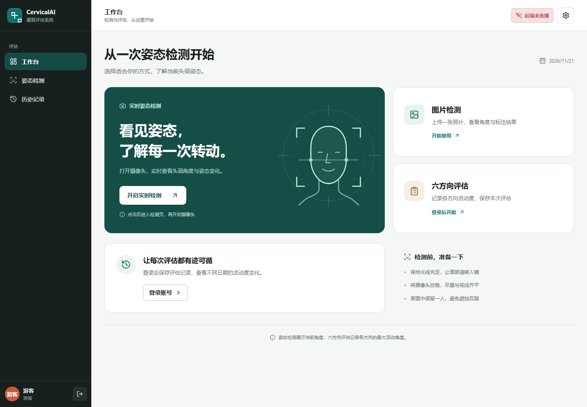
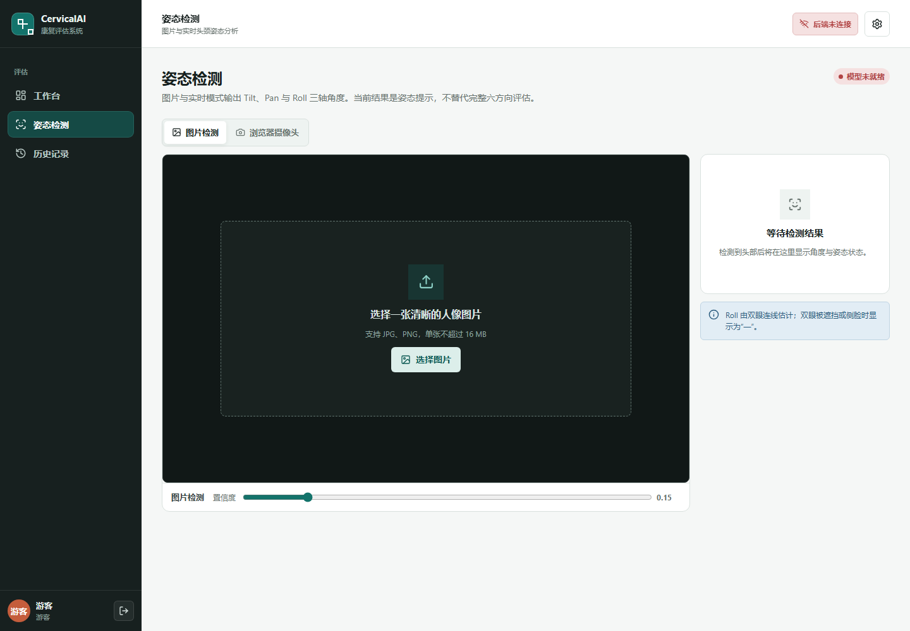
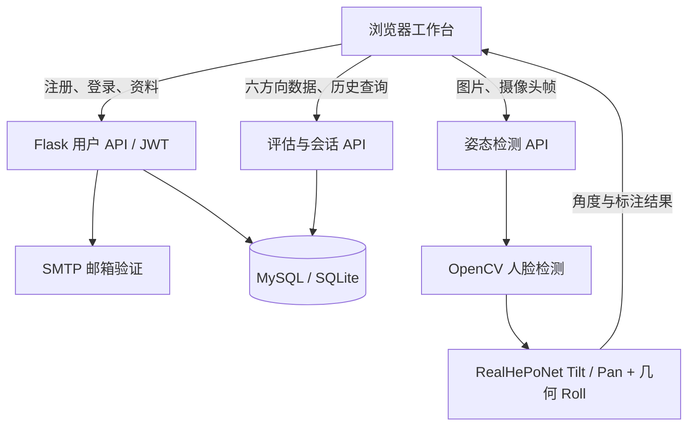

<div align="center">

# CervicalAI Rehab

### 头颈姿态检测与颈椎活动度评估工作台

图片检测 · 浏览器摄像头 · 六方向评估 · 历史记录 · 邮箱验证


[界面展示](#界面展示) · [功能概览](#功能概览) · [系统架构](#系统架构) · [本地运行](#本地运行) · [接口速览](#接口速览)

</div>

## 项目介绍

CervicalAI Rehab 是一个面向颈椎康复评估场景的 Web 项目，将头颈姿态检测、活动度记录和历史回顾集中到同一工作台。用户可以上传图片或使用浏览器摄像头查看姿态角度，登录后记录六方向活动度并查看分级、摘要和变化趋势。

**仓库状态：** 仓库包含前后端业务源码、配置模板、训练与评测脚本、现有测试、界面截图和预训练模型数据。姿态模型权重以分片形式保存，运行前执行一次还原脚本即可；依赖环境仍需按现有模型版本配置。

## 界面展示

以下图片均截取自实际前端页面，展示登录入口、游客工作台和图片检测初始界面。截图时未连接后端，页面上的连接状态与空白检测区域保留真实状态；未填充模拟检测结果。

### 登录与邮箱验证入口

支持账号登录、邮箱验证码和游客体验入口。



### 工作台

集中进入姿态检测、评估与记录功能；游客可先体验检测界面。



### 姿态检测

在图片上传和浏览器摄像头模式间切换，查看姿态角度、检测状态与结果区域。



## 功能概览

| 模块 | 当前本地版本的能力 |
| --- | --- |
| 用户与认证 | 注册、用户名或邮箱登录、真实邮箱验证码、JWT 身份验证、个人资料及密码修改 |
| 图片姿态检测 | 上传图片，检测人脸并返回姿态角、检测框和标注图片 |
| 浏览器摄像头 | 采集访问者设备画面，逐帧调用后端推理并展示角度变化 |
| 六方向活动度 | 录入前屈、后伸、左右侧屈、左右旋转的最大活动角度，由后端统一计算四级分级 |
| 摄像头会话记录 | 保存起止时间、时长、有效帧数、三轴统计和曲线采样点 |
| 历史与趋势 | 查看评估历史、详情、摘要和趋势，单独回顾摄像头检测会话 |
| 数据持久化 | MySQL 或 SQLite 保存用户、评估、会话及邮箱验证相关数据 |

公开前端入口面向患者。游客的摄像头记录保存在当前浏览器，最多保留最近 100 次；登录用户的会话可同步到账号。会话记录保存统计与采样点，不保存摄像头视频。

### 姿态角与活动度的区别

| 项目 | 数据来源 | 用途 |
| --- | --- | --- |
| Tilt | RealHePoNet 模型输出 | 当前帧俯仰姿态 |
| Pan | RealHePoNet 模型输出 | 当前帧左右转头姿态 |
| Roll | OpenCV 双眼中心连线的几何估计 | 当前帧侧倾；双眼识别不可靠时返回 `null` |
| 六方向活动度 | 分别测得并录入的最大活动角度 | 按代码中的规则计算正常、轻度、中度、重度分级 |

单帧姿态角不能直接代表完整活动度范围，摄像头会话统计也不会参与六方向评估分级。当前分级采用规则计算，未将训练脚本中的分类模型作为已完成的线上分级能力。

## 系统架构



前端使用原生 HTML、CSS 和 JavaScript，通过 HTTP API 与 Flask 通信，无需 npm 运行时依赖。模型权重保存在后端本地，首次推理时延迟加载。

### 本地开发目录

以下为仓库中的主要目录；姿态模型分片和还原脚本位于模型目录。

| 路径 | 职责 |
| --- | --- |
| `frontend/index.html` / `styles.css` | 页面入口与样式 |
| `frontend/app.js` / `api.js` / `icons.js` | 界面逻辑、API 客户端、图标 |
| `frontend/build.cjs` / `bundle.js` | 零依赖打包脚本与浏览器产物 |
| `backend/app.py` / `config.py` | Flask 应用入口与环境配置 |
| `backend/api/` | 用户、评估、摄像头会话路由 |
| `backend/models/` / `services/` / `utils/` | 数据模型、业务服务、校验与分级 |
| `backend/ml/model_weights/headpose/` | 姿态估计与人脸检测模型文件 |
| `backend/ml/train_model.py` / `evaluate_model.py` | 评估分类模型的训练与评测脚本，需另行准备数据和兼容环境 |
| `backend/tests/` | 数据库、邮箱登录、会话与 Roll 等现有测试 |
| `docs/images/` | README 页面截图 |

## 本地运行

先获取项目源码，再按下文准备运行环境并还原模型文件：

```powershell
git clone https://github.com/jiangsihong/CervicalAI_Rehab.git
cd CervicalAI_Rehab
```

### 1. 准备运行环境

| 组件 | 说明 |
| --- | --- |
| 浏览器 | 支持现代 JavaScript 与 `getUserMedia` 的浏览器 |
| 前端构建 | Node.js，用于运行 `build.cjs`；无需 `npm install` |
| 后端推理 | 现有权重按 Python 3.7 + TensorFlow 1.15 环境集成，可使用 CPU |
| 数据库 | 本地体验可显式选择 SQLite；代码默认选择 MySQL |
| 邮件服务 | 注册和登录需要配置可用的 SMTP 发件服务 |

`backend/requirements.txt` 保留了当前依赖清单，其中部分包的版本需要与旧版 Python / TensorFlow 环境重新核对；尚未验证在全新环境中直接整表安装。已有 `realheponet` Conda 环境的开发机可先复用该环境。训练与评测脚本需要单独核对依赖，不能直接视为姿态模型的训练入口。

### 2. 配置后端

在项目根目录打开 PowerShell，进入已经配置好推理依赖的环境：

```powershell
conda activate realheponet
cd backend
Copy-Item .env.example .env
```

编辑 `backend/.env`，设置独立的随机 `SECRET_KEY`、`JWT_SECRET_KEY`，并填写自己的发件服务参数：

```dotenv
DB_TYPE=sqlite
SECRET_KEY=replace-with-a-long-random-secret
JWT_SECRET_KEY=replace-with-another-long-random-secret

MAIL_HOST=smtp.your-provider.example
MAIL_PORT=465
MAIL_SECURITY=ssl
MAIL_USERNAME=your-sender@example.com
MAIL_PASSWORD=your-smtp-authorization-code
MAIL_FROM=your-sender@example.com
```

上面的邮箱值均为占位示例，请按实际服务商配置。`MAIL_SECURITY` 支持 `ssl` 和 `starttls`。未配置邮件服务时不能完成注册或登录验证，但可先查看游客界面。真实 `.env` 和 SMTP 授权码只保留在本机。

如使用 MySQL，将 `DB_TYPE` 改为 `mysql`，创建数据库并配置 `MYSQL_HOST`、`MYSQL_PORT`、`MYSQL_USER`、`MYSQL_PASSWORD`、`MYSQL_DATABASE`。当前数据库不仅保存用户信息，也保存评估记录、会话及验证数据。

### 3. 准备模型并启动后端

确认以下文件位于 `backend/ml/model_weights/headpose/`：

| 文件 | 用途 |
| --- | --- |
| `pose-estimator.h5` | RealHePoNet 姿态估计权重 |
| `deploy.prototxt` | OpenCV DNN 人脸检测网络定义 |
| `res10_300x300_ssd_iter_140000.caffemodel` | 人脸检测权重 |

仓库已包含 `deploy.prototxt` 和人脸检测权重。`pose-estimator.h5`（约 78 MiB）以 10 个分片保存；在项目根目录执行以下命令，还原脚本会验证每个分片及完整文件的 SHA-256：

```powershell
python backend/ml/model_weights/headpose/restore_weights.py
```

还原后会在同目录生成 `pose-estimator.h5`。已有完整且校验正确的文件时会跳过，不会覆盖校验不一致的原文件。详见 [模型文件说明](backend/ml/model_weights/headpose/README.md)。

在 `backend` 目录运行：

```powershell
$env:DB_TYPE = "sqlite"
python app.py
```

后端地址为 `http://127.0.0.1:5000`。启动时会自动创建缺失的数据表，**无需执行 `init-db`**；该命令会删除并重建业务表。

开发机也提供 `start_backend_realheponet.bat`，但脚本内固定了 Conda 安装路径，其他机器使用前应调整。

### 4. 启动前端

另外打开一个终端，在项目根目录执行：

```powershell
cd frontend
node build.cjs
python -m http.server 5173
```

访问 **http://127.0.0.1:5173**。默认后端地址为 `http://127.0.0.1:5000`，也可在界面的连接设置中修改。

浏览器摄像头需要设备授权，开发时使用 `localhost` 或 `127.0.0.1`，远程访问时使用 HTTPS。修改 `app.js`、`api.js` 或 `icons.js` 后，重新运行 `node build.cjs`。

### 5. 检查服务

```powershell
Invoke-RestMethod http://127.0.0.1:5000/api/assessment/pose/status
```

`ready_for_inference` 表示所需模型文件齐备，`loaded` 表示模型已加载；模型文件齐备不等于已完成一次成功推理，首次图片检测仍需验证 TensorFlow 环境。

## 接口速览

除标记为公开的接口外，下表接口均需在请求头中携带 `Authorization: Bearer <access_token>`。

| 方法 | 路径 | 用途 | 访问 |
| --- | --- | --- | --- |
| POST | `/api/user/email-code` | 发送注册或登录邮箱验证码 | 公开，按用途校验 |
| POST | `/api/user/register` | 注册患者账号 | 公开，验证邮箱 |
| POST | `/api/user/login` | 登录并获取 JWT | 公开，验证密码与邮箱 |
| GET / PUT | `/api/user/profile` | 获取或更新个人资料 | 登录 |
| POST | `/api/user/change-password` | 修改密码 | 登录 |
| GET | `/api/assessment/pose/status` | 模型文件与加载状态 | 公开 |
| POST | `/api/assessment/pose/image` | 上传图片或摄像头帧检测 | 公开 |
| POST | `/api/assessment/submit` | 提交六方向活动度评估 | 登录 |
| GET | `/api/assessment/history` | 查询评估历史 | 登录 |
| GET | `/api/assessment/<id>` | 获取评估详情 | 登录及记录权限校验 |
| GET | `/api/assessment/summary` | 获取评估摘要 | 登录 |
| GET | `/api/assessment/trend` | 获取评估趋势 | 登录 |
| PUT | `/api/assessment/pose/sessions/<id>` | 保存或更新摄像头会话 | 登录 |
| GET | `/api/assessment/pose/sessions` | 查询摄像头会话历史 | 登录 |
| GET | `/api/assessment/pose/sessions/<id>` | 获取摄像头会话详情 | 登录 |

例如，在项目根目录用真实图片发起检测（Windows PowerShell 使用 `curl.exe`）：

```powershell
curl.exe -X POST "http://127.0.0.1:5000/api/assessment/pose/image?annotated=true" -F "image=@sample.jpg"
```

请将 `sample.jpg` 替换为自己的图片路径。返回内容包含检测数量、主要检测对象、姿态角度及可选标注图片。

## 开发状态与后续工作

- 整理并验证可复现的依赖环境。
- 补充预训练模型的上游来源、版本和分发许可说明。
- 为训练与评测流程补齐数据准备、环境和实际验证结果。
- 在真实设备与不同拍摄条件下验证姿态估计及邮件收发。

项目目前用于课程开发与功能验证，姿态提示和规则分级不作为临床诊断结论。
